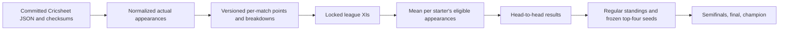

# Technical architecture — playable historical season

One mobile-first Next.js application, not a microservice fleet. Real competitions, players, matches and source statistics remain separate from each private fantasy league's membership, draft, XI and results.

## Stack and modules

- Next.js App Router, React and TypeScript; Node **22.x** in development, CI and Vercel.
- Supabase Auth, user-scoped SSR clients and PostgreSQL. No service-role key in application clients, actions or public variables.
- Original custom CSS design system, locally bundled Manrope and Lucide. Desktop sidebar; mobile global/contextual bottom navigation.
- Existing Free Supabase project `irdolhsdemjugrsgfuuc`, `us-west-1`; existing Hobby Vercel project `prj_VYvlYPp8UDKDlJ2pIVGfVlpp9wah` in `anshbalusa-8318s-projects`. No duplicate projects or plan changes.
- `src/lib/auth`, `users`, `leagues`, `supabase`: identity, profiles, invitations, membership and typed user clients.
- `src/lib/fantasy`: pure scoring, snake order, XI validation/feasibility and historical schedule logic.
- `src/lib/ingestion/cricsheet.ts`, `scripts/import-cricket.ts`: provider parsing and transactional operator import, separate from user league state.
- `src/lib/catalog`: authenticated real-source read models, player history and published fixture calendar.
- `src/lib/gameplay`: explicit snapshot/history DTOs, authenticated queries and server actions; no-store league/player GET routes in `src/app/api/`.
- `src/components/gameplay`, `catalog`, `fantasy`, `ui`: real league screens, shared score audit UI and visual foundations. `/demo` alone remains fictional browser-only practice.

## Authentication and origins

`src/proxy.ts` validates/refreshes sessions, forwards refresh cookies/cache headers and retains the protected path/query. Queries/actions independently require a genuine Auth user; database authorization is authoritative.

Signup and recovery email origins come from `NEXT_PUBLIC_SITE_URL`, or Vercel's own generated `VERCEL_URL` in a preview environment. Request/forwarded-host headers cannot select an email origin. Production requires HTTPS.

The callback supports standard PKCE code exchange and the separate versioned token-hash confirmation template. Ambiguous credential combinations are rejected; only validated relative `next` paths survive. PKCE links must open in the same browser/exact origin that requested them. Password recovery uses ordinary delivered recovery mail and authenticated password update, not admin confirmation or impersonation.

The existing hosted Site URL and narrowly scoped production/preview/local callbacks are documented in README. Default hosted-mailer restrictions and production SMTP delivery are separate from database/CLI authorization.

## Draft and reconnect

1. Commissioner start locks a complete six-member lobby, validates the real season pool and assigns seats by join timestamp/user ID.
2. PostgreSQL owns pick number, turn, deadline, revision and immutable picks. A unique `(league_id, player_id)` prevents duplicate ownership; `(league_id, pick_number)` prevents duplicate turns.
3. Manual picks require caller membership, current ownership of the turn, an unexpired deadline and the expected pick number. Global role feasibility reserves every manager's typed minima and remaining squad slots.
4. An expired-turn tick is member-callable but chooses its candidate on the server; the caller cannot pick for another manager. Competing ticks/picks serialize and stale requests cannot advance twice.
5. Visible drafting rooms poll every five seconds; other views every twenty. Hidden polling pauses. Refreshes abort/sequence older requests; loss of authorization/connection blocks local mutations until reconnection. A lost mutation response reports uncertain outcome rather than falsely claiming no write occurred.
6. The displayed countdown advances locally from the received server timestamp. Only a fresh server action authorizes a pick/timeout. There is no background offline timer service: reconnect resolves an expired turn.

The real source window calendar is readable before drafting. Pick 90 atomically completes six 15-player squads, creates the five regular pairings plus playoff windows and initializes valid XIs.

## Historical scoring and state transitions

Seven date-only windows group the 34 real source matches without splitting same-day fixtures. Historical **Lock & replay** is explicit; it does not pretend that old fixtures have future kickoff times. A save and lock serialize on the same league row. Only the owner sees an open XI; locking exposes participating XIs to members.

Authoritative contribution, matchup and standings values use PostgreSQL `numeric` without a three-decimal storage limit. Display alone rounds to one decimal. Actual appearances, including zero-contribution XIs and credited substitute fielders, determine averages; benches and nonappearances contribute zero.

Five regular rounds form a full six-team round robin. Top-four seeds freeze after Round 5, then 1–4 and 2–3 semifinals, followed by a final. Exact playoff ties favor the higher seed. Recalculation uses frozen XIs and versioned source points; it updates results/champion within already frozen bracket identities, not retroactively redrawing participants. See [GAME_RULES.md](GAME_RULES.md).

## RPC security matrix

The deployed definitions and grants were inspected directly after migration. Every one of these fifteen public SECURITY DEFINER functions checks `auth.uid()`, fixes `search_path = ''`, allows `authenticated` execution and denies `anon`/PUBLIC execution. The UI is not the permission boundary.

| RPC                  | Required identity/authority                                                                                        |
| -------------------- | ------------------------------------------------------------------------------------------------------------------ |
| `create_league`      | Creates commissioner/team for caller; validates imported, complete MLC season and names atomically.                |
| `join_league`        | Caller presents an active expiring hash-only invite; lobby/capacity/duplicate checks repeat under the league lock. |
| `create_invitation`  | Commissioner, lobby state; rotates previous secret.                                                                |
| `revoke_invitation`  | Commissioner of the resolved invitation's league.                                                                  |
| `rename_team`        | Member; derives only caller's own team.                                                                            |
| `rename_league`      | Commissioner and lobby state.                                                                                      |
| `leave_league`       | Member in lobby, not commissioner; removes only caller's membership/team.                                          |
| `start_draft`        | Commissioner; exactly six managers/teams and a complete supported season.                                          |
| `make_draft_pick`    | Member/current manager, expected pick, deadline, season eligibility and globally feasible exclusive ownership.     |
| `draft_tick`         | Member; server-selected feasible auto-pick only for an expired turn.                                               |
| `save_lineup`        | Member's own participating team, open round, eleven distinct eligible owned players, no lock.                      |
| `replay_round`       | Commissioner of the target league; current open round or idempotent locked-round scoring.                          |
| `recalculate_league` | Commissioner; at least one completed round, frozen lineups and existing bracket.                                   |
| `get_league_game`    | Member only; preserves open-XI privacy and excludes invitation secrets/user emails.                                |
| `get_player_history` | Member and source player belonging to that league's season.                                                        |

All 24 public tables have RLS. Fantasy reads require membership; catalog reads require authentication. The summary view uses `security_invoker=true`. Direct catalog/gameplay writes are revoked; only profile display-name updates are narrowly writable. Private mutation helpers and the signup trigger cannot be executed by client roles. Policy membership helpers are caller-scoped, outside the exposed schema.

The original seven SECURITY DEFINER warnings remain intentional; the eight gameplay/read RPCs bring that class to **15**. Revoking authenticated access would break required authorized operations, not fix a demonstrated vulnerability. One additional leaked-password-protection warning remains on Free; the provider documents that feature as Pro-only. Neither warnings nor RLS were suppressed, and no upgrade was purchased.

## Source operations and deployment

Imports preserve source IDs, raw checksums, eligibility provenance, point versions and category breakdowns. Identical imports/recalculations do not duplicate results. Provider normalization has edge fixtures and an independent two-scorecard/12-player audit. Published migrations are immutable; structural catalog corrections require forward migrations.

The existing five hosted migration versions match source files, including guarded reconciliation of only MCP-generated migration metadata. No destructive harness or SQL-auth fixture runs against hosted data. Vercel's authenticated local CLI verifies the existing project and three public variables in development/preview/production; GitHub `main` remains production and other branches trigger protected previews.

Actual runtime smoke used native Supabase Auth v2.197.0, PostgREST v16.5, PostgreSQL 17.11 and Mailpit: seven ordinarily registered/confirmed accounts, six-manager 90-pick season, races/permissions, saved/locked XIs, seven rounds and repeatable champion. This is not a substitute for a real hosted six-person email rehearsal or verified production SMTP.

## Not claimed implemented

No live provider/SLA, native app, league chat, trades, waivers, salary/auction draft, predictions, current-season injury service or universal official-role dataset. No real-money product. Human alpha participation and schedule/eligibility fairness remain validation work rather than fabricated implementation evidence.
